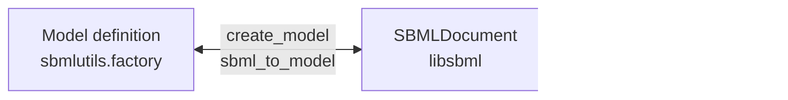
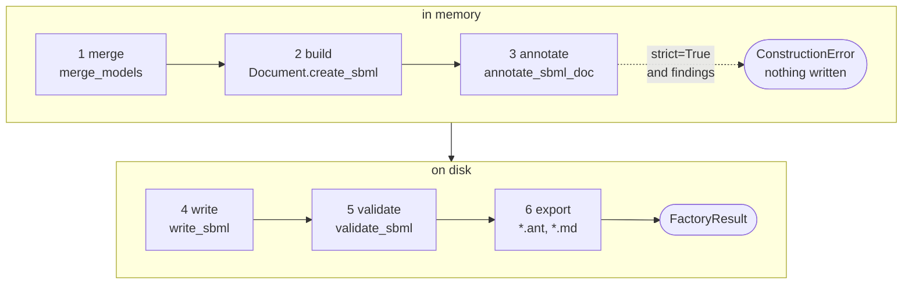
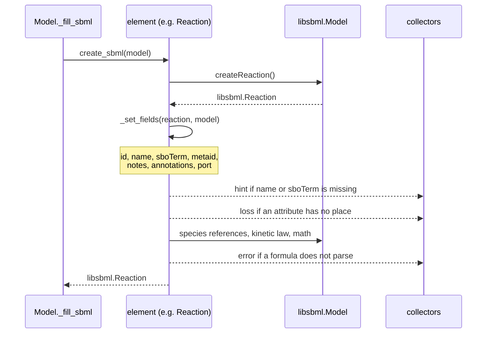
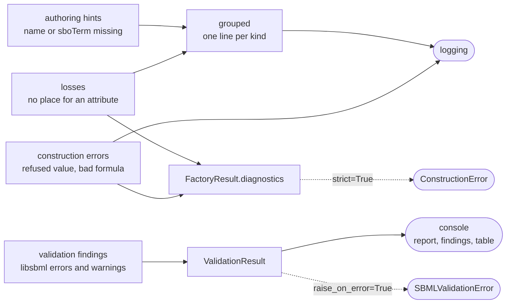
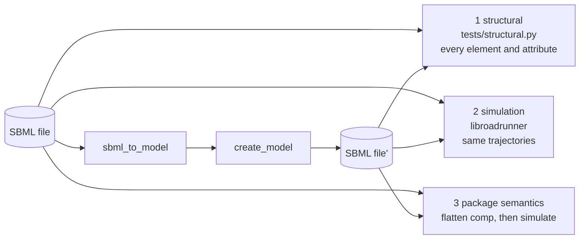

# How it works

This page explains what happens between a python model definition and a validated SBML file, how the package reports what it finds on the way, and what to tune when a model gets large. It is background for the [user guide](creation.md); none of it is needed to write a first model.

## The big picture

SBML is an XML format, and libsbml is the library which reads, writes and checks it. `sbmlutils` adds two directions on top of libsbml: from a python definition to SBML (the **factory**) and from SBML back to a python definition (the **parser**). Everything else, validation, reports, conversion and the package helpers, works on the libsbml document in between.



Everything else works on the libsbml document or the file in between:

| task | entry point | guide |
| --- | --- | --- |
| check a model | `validate_sbml`, `validate_doc` | [Validation](validation.md) |
| import other formats | `antimony_to_sbml`, `xpp2sbml` | [Antimony](io/antimony.md), [XPP](io/xpp.md) |
| export other formats | `sbml_to_antimony`, sbmlode | [Antimony](io/antimony.md), [ODE export](ode.md) |
| hierarchical models | `flatten_sbml`, `merge_models` | [comp](packages/comp.md) |
| describe a model | `SBMLDocumentInfo` | [Reports](reports.md) |
| download a model | `sbmlutils.biomodels` | [COMBINE archives](omex.md) |

The definition is plain python data: a `Model` holds `Compartment`, `Species`, `Parameter`, `Reaction` and the other elements, and every element derives from `Sbase`. Because it is data, a model can be composed from several modules, generated in a loop, parameterized and merged, and the units, annotations and notes stay with the element they describe.

## Creating a model

`create_model` is the entry point. It runs the steps below in this order; each box names the function which does the work.



The findings of steps 1 to 4 are collected while the document is built and written, and reported once per kind when the file is written, see [Output and reporting](#output-and-reporting); `strict_preservation=True` rejects the known losses of a parsed model before step 1.

Two details explain much of the design:

- **The packages are decided before the document exists.** libsbml cannot enable a package on a document after it is created, so `Document.create_sbml` first walks the whole definition and reads off which packages the content needs (a port needs comp, a gene product needs fbc, an uncertainty needs distrib), and only then builds the namespaces and the document.
- **The written file is validated, not the document in memory.** libsbml checks a constructed document differently from one it has read, in particular with comp external model definitions, so `create_model` validates what a user of the file will read.

### Creating one element

Every element is created in two steps. `create_sbml` creates the libsbml object on its parent, `_set_fields` sets the attributes on it. The model being filled is handed down, never looked up: libsbml answers `getModel()` of an element inside a `<comp:modelDefinition>` with the model of the document, so an element which looked up its own model would resolve the ids of its math against the wrong one.



## Output and reporting

The package separates **output** from **logging**, see [Installation](installation.md#output-and-logging):

- **Output** is what you asked to see: the files `create_model` writes, the report of a validation with its findings, the summary of a flattening or a download. It is printed on the rich console of the package, `sbmlutils.console.console`, with colors, tables and links to the files, and silenced with `sbmlutils.console.quiet()`.
- **Logging** is for tracing problems and debugging: the warnings about a definition which should be fixed or content which is lost, the errors of libsbml calls which failed, and debug detail. It goes to the standard `logging` module, which the package never configures.

What writing and checking a model finds reaches the caller on different paths:



A session with a small model prints the file it wrote and the validation, and the hints of the definition show up as warnings once logging is shown on the console with `log.enable_rich_logging()`:

```
WARNING  'name' should be set on 2 Species elements: 'S1', 'S2'
SBML written to minimal_model.xml  model 'minimal_model', 0.01 s
valid /home/user/models/minimal_model.xml  0.001 s
```

A model with findings gets a full report instead of the last line: a rule, the file, the status with the counts, every finding colored by its severity, and the table of the findings grouped by error id, see [Validation](validation.md#the-report).

**Findings are grouped.** A large model repeats the same finding on thousands of elements: a missing `name` on every species, an attribute the SBML level has no place for, a unit warning on every reaction. Reporting each of them buries the one decision which fixes all of them, and rendering ten thousand lines on a rich console took longer than writing the model. So inside one document every hint and loss is collected under a key and one warning per key is logged when the document is done, with the count and the first elements:

```
WARNING  'name' should be set on 2000 Species elements: 'S0', 'S1', 'S2', 'S3', 'S4' and 1995 more
```

Validation does the same for the findings of libsbml: `ValidationOptions.max_findings_per_error` (10 by default) caps how many findings with the same id are printed one by one, and the table lists every error id with its count. The `ValidationResult` always holds every finding, and `console.print(result)` renders the table again at any time.

**Construction findings are data.** Every loss and every construction error is also recorded as a `ConstructionDiagnostic` on `FactoryResult.diagnostics`, also when validation is skipped. `strict=True` turns them into a `ConstructionError` before anything is written, which is what a pipeline wants: a formula with a typo then stops the build instead of producing a reaction without a rate law.

## Performance

Writing a model is fast; the time goes into libsbml. For a generated model with 2000 species, 2000 parameters and 2000 reactions, each with a unit and an annotation, `create_model` takes about 1.2 s on a laptop:

| step | time | what it is |
| --- | --- | --- |
| create and write the document | 0.27 s | parsing 2000 formulas and serializing the XML, mostly libsbml |
| validation, all checks | 0.95 s | reading the file back and the consistency checks of libsbml |
| validation without units | 0.47 s | `ValidationOptions.fast()` |

What helps when a model gets large:

- **Skip or reduce the validation while iterating.** `validate=False` writes the model without checking it, `validation_options=ValidationOptions.fast()` skips only the unit analysis, which is the expensive check and allocates much more memory than the model itself. Validate with the default options before a model is shared or simulated.
- **Keep the console quiet in batch runs.** Rendering output is not free. The grouped reporting keeps the output of a large model to a few lines; `with quiet():` from `sbmlutils.console` drops the printed output of a batch of models, and the level of the `sbmlutils` logger decides about the warnings.
- **Write the model once.** `create_model` accepts a list of models and merges them before writing, which is cheaper than writing and merging several files.
- **Import once.** Importing `sbmlutils.factory` takes about half a second, most of it libsbml and pint; pandas is imported only when an annotation spreadsheet is read.

## Security

Models are often downloaded or uploaded, so the package treats an SBML file as untrusted input:

- **No external entities.** libsbml parses with expat and does not resolve an external entity: a document which declares one to read a local file is rejected with `Undefined XML entity`. The MathML which `sbmlutils.report.mathml` turns into latex is parsed with entity resolution and network access switched off, and the packaged XSLT stylesheets may neither touch the network nor write files.
- **Bounded input.** `read_sbml` and `validate_sbml` accept `max_bytes`, which limits the decompressed size before parsing (also for `.gz`, `.bz2` and `.zip`), and `allow_external_models=False`, which rejects comp external model definitions before libsbml resolves their sources, see [Reading and writing](io.md).
- **Downloads stay in place.** `sbmlutils.biomodels` checks a BioModels id before it is used in a URL or a path, keeps the files of an archive inside the output directory, uses a session with timeouts and retries, and writes a download to a partial file which replaces the target only when it is complete.
- **Reports stay local.** `report.sbmlreport` serves the one model it opens on the loopback address only, for ten seconds by default, and answers every other path with 404.

## Verifying the round trip

The parser and the factory are each other's inverse, and the test suite checks that in three layers, because no single check is enough: libroadrunner refuses fbc, ignores distrib and flattens comp, and a document stripped of all three still validates.



The structural comparison treats exactly three normalizations as equal (a gene product association flattened by libsbml, a `<cn>` gaining `type="integer"`, an annotation resource canonicalized to its identifiers.org URL); every other difference is a failure. `scripts/package_report.py` and `scripts/roundtrip_report.py` run the comparison over the whole corpus, see [Contributing](development.md).

## The factory modules

`sbmlutils.factory` is a facade: `from sbmlutils.factory import *` gives the names of its modules, which follow the SBML packages and import each other in one direction only:

| module | holds |
| --- | --- |
| `_core` | `Sbase`, `KeyValuePair`, the loss reports and the helpers the elements share |
| `units` | `Units`, `UnitDefinition`, `ModelUnits` |
| `core_elements` | the elements of SBML core, `Compartment` to `Event` |
| `distrib` | `Uncertainty`, `UncertParameter`, `UncertSpan` |
| `fbc` | `GeneProduct`, `Objective`, `FluxObjective`, `UserDefinedConstraint` |
| `comp` | `Submodel`, `Port`, `ReplacedElement`, `ReplacedBy`, `Deletion` |
| `model` | `Model`, `ModelDefinition`, `Document`, `create_model` |

Each module imports only the ones above it in the table; a later one is imported only for the type checker. So a new element type goes into the module of its package, and `model` sees all of them.
